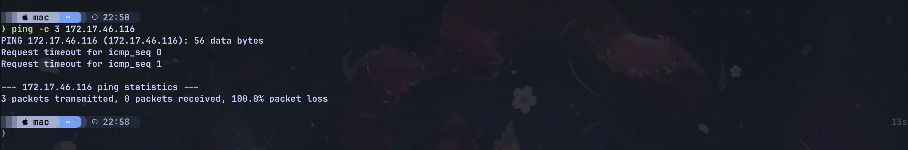
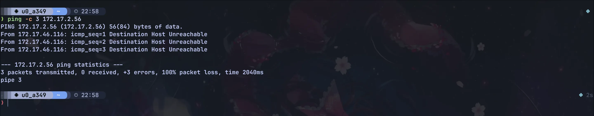
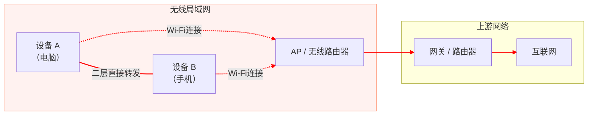
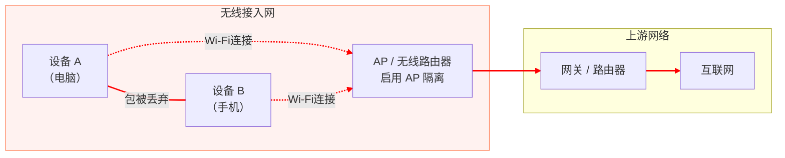
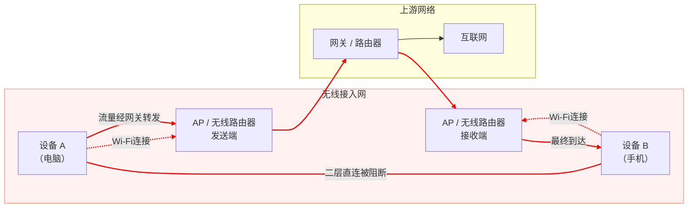
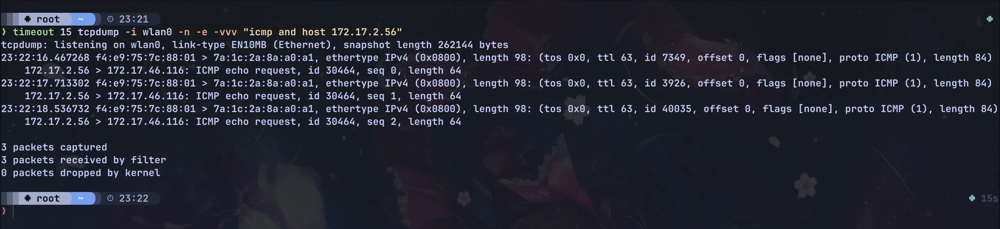
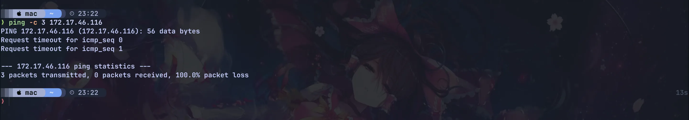
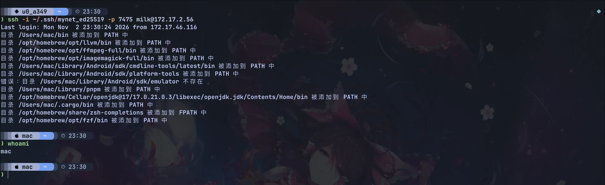

:::note
截至目前，本人尚未完全查明校园网设备间通信隔离的全部机制。本文记录了已验证的绕过方案与若干尝试，旨在分享复现细节与分析结论；如有读者发现更优方案或能补充原理，欢迎在评论区交流与指正。若存在错误或表述不清之处，也欢迎批评指正。

本文探索的绕过隔离方案为：删除子网默认直连路由而设置路由要求通讯经由网关中转，从而绕开对局域网直连的限制。理论上可能跳数变多，但是局域网通信速度仍然比其他方案高得多。
:::

如果只希望看到客户端隔离的绕过办法，只需要阅读：[单向通信解决](#134-尝试解决电脑到手机) 和 [双向通信解决](#135-尝试解决手机到电脑)，事实上两个操作是对称的，只要阅读一个就有解决这类问题的办法了。

## 目录

- [目录](#目录)
- [1. 教学楼网段](#1-教学楼网段)
  - [1.1. 实验背景](#11-实验背景)
  - [1.2. 实验设备与网络环境](#12-实验设备与网络环境)
  - [1.3. 实验步骤](#13-实验步骤)
    - [1.3.1. IP 地址与子网分析](#131-ip-地址与子网分析)
    - [1.3.2. 初步测试：无法 ping 通](#132-初步测试无法-ping-通)
    - [1.3.3. 推测](#133-推测)
    - [1.3.4. 尝试解决：电脑到手机](#134-尝试解决电脑到手机)
    - [1.3.5. 尝试解决：手机到电脑](#135-尝试解决手机到电脑)
- [2. 宿舍网段](#2-宿舍网段)
- [3. 组网工具推荐：EasyTier](#3-组网工具推荐easytier)
- [参考文献](#参考文献)

## 1. 教学楼网段

### 1.1. 实验背景

在日常使用场景中，设备间快速传输文件是一项常见需求。许多人习惯使用微信文件传输助手进行传输，问题在于：

- 微信会将 `.png` 自动转为 `.jpg`，导致带透明通道的图片丢失透明信息。
- 某些可执行或安装包（如 `.apk`）在传输后会被改名为 `.apk.1`，用户需手动恢复后缀，体验不佳。
- 大文件传输速度较慢，且在网络不稳定时容易中断，并且有文件大小上限。
- 存在隐私与安全风险。

因此，使用基于 `rsync` 的局域网传输是更为理想的替代方案，优点包括：断点续传、增量同步、可选压缩以加速传输、以及基于 `ssh` 的加密通道以提高安全性。但要在局域网内使用 `rsync`，前提是两台设备必须能够互相连通。然而在校园网环境下，经常遇到同一子网内设备无法直接互通的情况。

因此本文的目标是分析该限制的成因并记录可复现的绕过思路与实践细节。

### 1.2. 实验设备与网络环境

- **实验设备**：一台 macOS 笔记本与一台已获取 root 权限的 Android 手机。理论上任意两台可修改路由表或防火墙规则的设备都可执行类似实验，但因我手上只有一台电脑与一部手机，所以大部分操作在手机端完成；若使用两台电脑，某些步骤可能更容易复现与调试。
- **网络环境**：中山大学珠海校区教学楼的校园网网段。需要说明的是，不同网络（如宿舍网段或校外 Wi‑Fi）可能存在不同的策略与表现，因此部分的结论基于上述教学楼网络的观测结果。
- **防火墙**：为了实验结果正确，需要放行对方的包，最简单的方法是完全关闭防火墙。

:::important
Android 手机使用 `termux` 进行实验，部分命令可能需要 `root` 权限与 `termux` 的 `root-repo` 部分包。
:::

### 1.3. 实验步骤

#### 1.3.1. IP 地址与子网分析

从两个设备获取各自的局域网 IP 地址。


```bash
ifconfig en0 | awk '/inet /{print $2}'
route -n get default | awk '/gateway:/ {print $2}'
```

```text
172.17.2.56
172.17.0.1
```


```bash
whoami
su
whoami
ifconfig wlan0 | awk '/inet /{print $2}'
```

```text
u0_a349
root
172.17.46.116
```

- 电脑的 IP 地址为 `172.17.2.56`
- 网关地址为 `172.17.0.1`
- 手机的 IP 地址为 `172.17.46.116`

教学楼的网段为 `172.17.0.0/18`，子网掩码为 `255.255.192.0`。进行与运算可知：
- `172.17.2.56 & 255.255.192.0 = 172.17.0.0`
- `172.17.46.116 & 255.255.192.0 = 172.17.0.0`

因此两台设备处于同一子网内，理论上可以直接通过 IP 地址进行通信。

#### 1.3.2. 初步测试：无法 ping 通

在电脑上执行 `ping -c 3 172.17.46.116`，发现无法连通；在手机上执行 `ping -c 3 172.17.2.56`，同样无法连通。并且双方的抓包结果表明双方都没有收到对方的包。



```text
PING 172.17.46.116 (172.17.46.116): 56 data bytes
Request timeout for icmp_seq 0
Request timeout for icmp_seq 1

--- 172.17.46.116 ping statistics ---
3 packets transmitted, 0 packets received, 100.0% packet loss
```



```text
PING 172.17.2.56 (172.17.2.56) 56(84) bytes of data.
From 172.17.46.116: icmp_seq=1 Destination Host Unreachable
From 172.17.46.116: icmp_seq=2 Destination Host Unreachable
From 172.17.46.116: icmp_seq=3 Destination Host Unreachable

--- 172.17.2.56 ping statistics ---
3 packets transmitted, 0 received, +3 errors, 100% packet loss, time 2040ms
```

#### 1.3.3. 推测

根据上述实验结果与一些资料的收集，推测校园网可能通过 **AP（Access Point，接入点）隔离**机制来限制。

在无线网络中，AP 通常起到把无线终端接入有线网络的作用，同时也可以负责数据的收发、转发。

在默认情况下，如果多个终端连接到同一个 AP，它们之间可以直接通过二层转发进行通信。例如，两台接入同一 Wi-Fi 的电脑之间，可以不经过外网网关直接互相传输文件。



然而，校园网或公共 Wi-Fi 场景中，往往会启用 AP 隔离机制。



因此，从实验结果推测，即便电脑和手机处于同一网段，由于 AP 隔离的存在，它们的数据包会被 AP 丢弃或阻断，导致无法直接互通。

换句话说，只要不再走二层直连，而是把包交给网关做三层转发，就能绕过 AP 对客户端之间二层转发的限制，因为 AP 不会阻止正常路由转发。

如果可以让请求包沿着 `A -> AP -> GW -> AP -> B`，响应包沿着 `B -> AP -> GW -> AP -> A` 路径传输，那么就能实现设备间的通信。

[参考文章 1：Windows 下 AP 隔离的解决方案](https://blog.csdn.net/qq_25177949/article/details/143834903)

[参考文章 2：Linux 下 AP 隔离的解决方案](https://www.cnblogs.com/wangbingbing/p/17931315.html)

:spoiler[那本文算不算弥补了没有 macOS 和 Android 的 AP 隔离解决方案呢？~~好吧其实和 Linux 基本上一样~~]



#### 1.3.4. 尝试解决：电脑到手机

首先，确认电脑和手机与网关之间的连通性。

在电脑上执行 `ping -c 3 172.17.0.1`，发现可以连通；在手机上执行 `ping -c 3 172.17.0.1`，同样可以连通。

其次，通过设置路由规则，让电脑和手机之间的流量先经过网关转发。

由于每次连接 Wi-Fi 时，路由表中就会被添加上子网间直连的路由规则，并且占据优先级较高，因此需要先删除原先的子网通信规则。然后再添加与对方通信经过网关的路由规则。


```bash
sudo route -n delete -net 172.17.0.0/18
sudo route -n add -host 172.17.46.116 172.17.0.1
```

```text
delete net 172.17.0.0
add host 172.17.46.116: gateway 172.17.0.1
```

成功移除默认子网路由并添加网关中继路由后，在电脑上重新 `ping -c 3 172.17.46.116`，发现手机已经可以收到包：



```bash
timeout 15 tcpdump -i wlan0 -n -e -vvv "icmp and host 172.17.2.56"
```

```text
tcpdump: listening on wlan0, link-type EN10MB (Ethernet), snapshot length 262144 bytes
23:22:16.467268 f4:e9:75:7c:88:01 > 7a:1c:2a:8a:a0:a1, ethertype IPv4 (0x0800), length 98: (tos 0x0, ttl 63, id 7349, offset 0, flags [none], proto ICMP (1), length 84)
    172.17.2.56 > 172.17.46.116: ICMP echo request, id 30464, seq 0, length 64
23:22:17.713302 f4:e9:75:7c:88:01 > 7a:1c:2a:8a:a0:a1, ethertype IPv4 (0x0800), length 98: (tos 0x0, ttl 63, id 3926, offset 0, flags [none], proto ICMP (1), length 84)
    172.17.2.56 > 172.17.46.116: ICMP echo request, id 30464, seq 1, length 64
23:22:18.536732 f4:e9:75:7c:88:01 > 7a:1c:2a:8a:a0:a1, ethertype IPv4 (0x0800), length 98: (tos 0x0, ttl 63, id 40035, offset 0, flags [none], proto ICMP (1), length 84)
    172.17.2.56 > 172.17.46.116: ICMP echo request, id 30464, seq 2, length 64

3 packets captured
3 packets received by filter
0 packets dropped by kernel
```

当然电脑 `ping` 手机仍然是超时（因为响应包无法回来）。



```text
PING 172.17.46.116 (172.17.46.116): 56 data bytes
Request timeout for icmp_seq 0
Request timeout for icmp_seq 1

--- 172.17.46.116 ping statistics ---
3 packets transmitted, 0 packets received, 100.0% packet loss
```

#### 1.3.5. 尝试解决：手机到电脑

尽管单向通信已经足够解决发送文件的问题了，但是显然极度繁琐，即使写成脚本，也不如直接双向通信方便。

那么接下来解决双向通信的问题。

在手机上执行以下命令（需要 `root` 权限）：

```bash
ip route del 172.17.0.0/18 dev wlan0
ip route add 172.17.2.56 via 172.17.0.1 dev wlan0
```

首先，进行 `ping` 的测试，在手机上执行 `ping 172.17.2.56`，发现可以连通。电脑上执行 `ping 172.17.46.116`，同样恢复连通。

其次，进行 `ssh` 的测试，在手机上执行 `ssh`，发现可以连通：



既然 `ssh` 已经可以连通，那么 `rsync` 也应该可以连通，因此这里就不进行测试了。:spoiler[~~那当然是因为无需测试而不是因为我当时忘记测试了啦。~~]

## 2. 宿舍网段

测试时，宿舍网段是 `172.27.0.0/17`，我的电脑 `172.27.74.6`，手机 `172.27.42.78`，网关 `172.27.0.1`。按照类似流程实验。

宿舍网段这边更加诡异，多次测试后出现了不同的状态。在未改变路由规则的情况下，有时单向通，有时双向通，有时全不通，通的时候丢包率也不稳定，因此没有继续测试。

## 3. 组网工具推荐：EasyTier

这篇文章撰写后一年，我遇到了 [EasyTier](https://github.com/EasyTier/EasyTier/) 工具，它是一个开源的 mesh VPN，通过组建虚拟局域网，我已经实现了设备间的互联，并且得益于虚拟局域网可以配置固定 IP，设备间的互联也变得更加方便，因此本文的方法只是作为参考。

## 参考文献

1. 我叫czc. 【windows】校园网AP隔离解决方案笔记-解决校内设备之间无法互相通信的臭毛病-附破解程序[J/OL]. CSDN, 2024-11-21. [在线访问](https://blog.csdn.net/qq_25177949/article/details/143834903)
2. 王冰冰. AP隔离的设备互相访问[J/OL]. 博客园, 2023-12-27. [在线访问](https://www.cnblogs.com/wangbingbing/p/17931315.html)

> 参考文献使用 **CC BY-SA 4.0** 协议授权。按照该协议，本文同样遵循 CC BY-SA 4.0 许可，允许商业或非商业用途的共享与再创作，但必须保留原作者署名，并以相同协议方式进行再发布。
